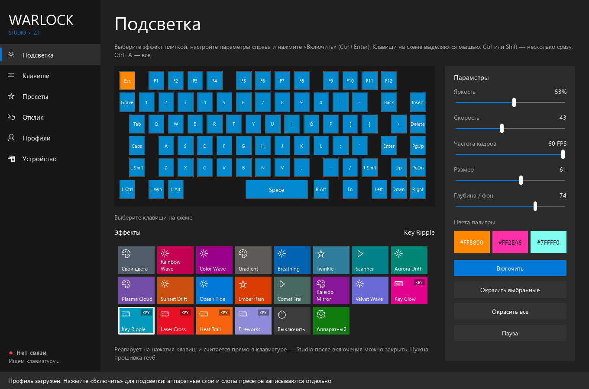

# Warlock Studio

Своя программа и кастомная прошивка для **ARDOR GAMING Warlock / GP75 (YC3121-L)**.
Windows 10 Metro UI, отдельный цвет каждой клавиши и автономная подсветка около
60 FPS — по кабелю и через 2.4 GHz свисток. Штатная программа и OpenRGB не нужны.



## Скачать

Готовые архивы находятся в [Releases](https://github.com/mur44ev/warlock-studio/releases/latest):

- **WarlockStudio-windows-x64.zip** — распаковать целиком и запустить `WarlockStudio.exe`.
- **AW60-rev9-firmware.zip** — проверенный образ rev9, USB-флешер и инструменты проверки.
- **SHA256SUMS.txt** — контрольные суммы архивов и образа прошивки.

Для программы нужен Windows x64 и [Microsoft Visual C++ Redistributable x64](https://aka.ms/vs/17/release/vc_redist.x64.exe).
Qt и HIDAPI находятся в архиве. Не запускайте одновременно Studio и другой
RGB-контроллер на этой же клавиатуре.

## Возможности

- 80 поклавишных цветов, 19 автономных эффектов; 5 реагируют на реальные нажатия.
- Три цвета палитры, яркость, скорость, размер, глубина и целевая частота кадров.
- 50 сохраняемых в клавиатуре слотов пресетов и переключение аппаратным сочетанием.
- Переназначение основного/Fn слоя, мультимедийные действия, блокировка Win.
- Аппаратные профили, резервные копии перед записью, проверка чтением обратно.
- Настройки debounce, монитор нажатий и диагностика прошивки по USB.
- USB и 2.4 GHz; расчёт автономной анимации продолжается после закрытия программы.

Редактора макросов в текущем Studio нет: прежние macro slots используются для
пресетов подсветки. Не используйте эту прошивку, если вам нужны сохранённые там макросы.

## Совместимость и установка прошивки

Это экспериментальная модификация **конкретной GP75 v1.04**, проверенная на одном
экземпляре Warlock с YC3121-L. Флешер принимает только model **919**, version **1.04**,
USB **3151:4015**, vendor HID FFFF:2. Конвертация исходной Warlock model1126/1.00
этим релизом не выполняется. Одного совпадения названия клавиатуры недостаточно.

1. Прочитайте [инструкцию по прошивке и восстановлению](docs/firmware.md).
2. Распакуйте архив прошивки целиком, установите Python 3 x64.
3. Закройте RGB-программы, подключите клавиатуру кабелем и включите USB-режим.
4. В каталоге распакованного архива сначала выполните проверку без записи:

   ```powershell
   py -3 firmware/aw60/flash_aw60.py
   ```

5. Для записи явно добавьте `--flash`. Пресеты сохраняются и восстанавливаются;
   чтение/восстановление 50 слотов может занять несколько минут.

   ```powershell
   py -3 firmware/aw60/flash_aw60.py --flash
   ```

Образ rev9 SHA256:
`e2c5c106cca91f49a05bc170d521f2ce823bfdc22f7ecde70b92bc032403fb27`.
Boot prefix проверяется по хешу и не отправляется на устройство.

Rev9 исправляет ошибку предыдущих ревизий: RGB-данные занимали штатный буфер
сохранения раскладки и могли испортить назначения, включая Enter/Fn.
**Rev7/rev8 для отката не используйте.** Если раскладка уже повреждена, сначала
установите rev9, затем восстановите собственную исправную копию; см. инструкцию.

## Что проверено

На одном устройстве: полная эмуляция реального Thumb-кода; 1516 случаев деления;
эквивалентность конвертера; CRC/кадры/очереди; 19 эффектов; запрет RGB-записей в
штатный буфер раскладки. После установки rev9 владелец проверил набор, Enter,
раскладку/Fn через USB и свисток. Радио-проверка устройства прошла 20/20 проверок:
раскладки целы до и после рендера и штатных запросов, новых ошибок нет.

Около 60 FPS измеряется по счётчику рендера, а не оптическим прибором. По радио
60 FPS относятся к автономным эффектам; произвольный поток полных RGB-кадров
достигает 60 FPS по кабелю, но ограничен штатным relay через свисток.
USB уже Full Speed / 1 мс (1000 Гц); разгона нет. Реальный скан клавиш — 500 Гц,
debounce задаётся в тиках по 2 мс, несмотря на прежнюю подпись «мс» в интерфейсе.
Аппаратное принудительное восстановление при неработающем приложении не проверено.

## Сборка исходников

```powershell
git clone --recurse-submodules https://github.com/mur44ev/warlock-studio.git
cd warlock-studio
$env:WARLOCK_QT_DIR = 'C:\Qt\5.15.2\msvc2019_64'
.\desktop\build.cmd
```

Нужны Qt 5.15 MSVC x64 и Visual Studio Build Tools с C++. HIDAPI закреплена
на версии 0.14.0; build.cmd собирает её из исходников. Выход: `dist/studio`.
`WarlockStudio.exe --self-test` проверяет профили/пресеты и рисует шесть экранов,
не обращаясь к клавиатуре. Исходники прошивки и тесты: [firmware/aw60](firmware/aw60).
Подробности: [разработка](docs/development.md), [протокол](docs/protocol.md).

## Лицензии

Studio и host-инструменты — GPL-3.0-or-later; прошивочный overlay и некоторые
общие заголовки сохраняют GPL-2.0-or-later согласно SPDX. Тексты в [LICENSE](LICENSE)
и [LICENSES](LICENSES). Неизменённые части вендорской прошивки не перелицензируются
под GPL. Сведения о Qt, HIDAPI, ANGLE и исходниках: [THIRD_PARTY.md](THIRD_PARTY.md).
Проект не является официальным продуктом ARDOR GAMING.
